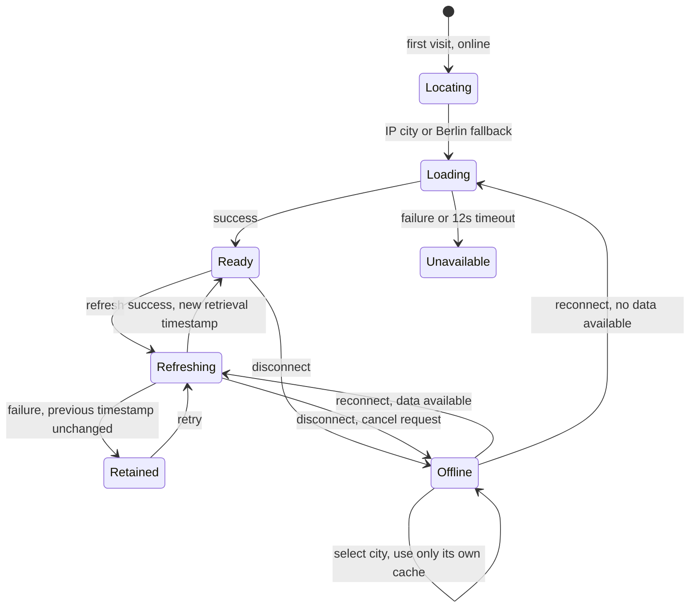

# Trustworthy asynchronous forecasts

Atmos distinguishes the selected place, an in-flight request, the forecast currently shown, and whether that forecast was saved successfully. The status below the current conditions announces these changes and names the city’s IANA timezone.

## State diagram



Any city selection cancels the active request immediately and advances a request ID. Its own saved snapshot is selected synchronously, or the old data is cleared if there is no cache. A response/error with an obsolete ID is ignored even if transport cancellation arrives too late. A selection during IP lookup also cancels that lookup. The offline state contains either the selected city’s previous forecast or an explicit “no forecast saved for this city” message. No city-search or forecast data is invented.

## What the times mean

| UI label                        | Meaning                                                                                                                                                                                                            | Changes when                                                                                              |
| ------------------------------- | ------------------------------------------------------------------------------------------------------------------------------------------------------------------------------------------------------------------ | --------------------------------------------------------------------------------------------------------- |
| Conditions forecast for         | `weather.current.time`, a model forecast’s valid instant. This is not a live sensor measurement, retrieval time, or proof that data is current.                                                                    | A new response provides another forecast time.                                                            |
| Retrieved                       | Legacy cache field `updatedAt`, the device-clock instant when a successful response was validated. This is not the provider’s model-run timestamp.                                                                 | A new validated response succeeds. Retries, failures, city switching, and reconnecting do not rewrite it. |
| Saved on this device            | The shown snapshot was read from storage or its write succeeded.                                                                                                                                                   | A validated snapshot is saved, or saving fails.                                                           |
| Not saved on this device        | The current response exists in memory, but persistence failed. It survives a failed refresh in that view; it may disappear on reload or city switching. Older snapshots already in storage may still be available. | Another write succeeds.                                                                                   |
| Saved forecast period has ended | Device time is beyond the last included hourly interval. Values remain visible as historical data, with a warning.                                                                                                 | A new response covers the present, or time advances beyond coverage.                                      |

Both absolute timestamps include year, date, time, and numeric UTC offset in the **selected city’s** timezone, not the device’s timezone. Repeated `02:30` at the autumn DST transition is distinguishable as `GMT+2` and `GMT+1`. Relative retrieval age uses elapsed milliseconds and updates every minute. It depends on the device clock; small future clock differences clamp to zero age. Invalid, non-positive, and more-than-five-minutes-future retrieval timestamps are rejected when loading storage. Old snapshots are retained deliberately, not silently given a new timestamp.

Repeated hourly labels also show their UTC offset. Hourly labels use actual forecast times rather than “Now”; daily rows use the forecast date’s weekday rather than “Today”. Daily values describe the saved forecast’s reference period. Outdoor suggestions are filtered against the device clock and update every minute; expired forecasts show a request for fresh data instead of a suggestion. A cached forecast can be several days old even if it was just opened.

## Failures, connectivity, and privacy

- Offline selection never initiates a forecast request. Disconnecting cancels pending work. Reconnection starts exactly one request for the place currently selected; duplicate online events do not cancel it or trigger another fetch.
- An online failure or 12-second forecast timeout retains the in-memory snapshot, including its original retrieval time, even when browser storage is blocked. An error with no snapshot shows a recoverable empty state. A successful retry clears the error.
- On first visit, shared coordinates and the last selected city take priority over IP lookup. IP lookup has a five-second timeout and validates the response, including provider-level failures returned with HTTP 200. Denied/unavailable device geolocation uses IP as a fallback; a failed fallback preserves the current city.
- `ipwho.is` receives the visitor’s IP as part of the connection. This does **not** require a browser geolocation permission prompt. Requests omit credentials and referrer, request only success/city/country/coordinates, and discard raw IP fields. Approximate city results are labeled, and VPN/network inaccuracies are disclosed in app details. Precise device location is requested only after “Use my location”; coordinates go to Open-Meteo for the forecast. Saved coordinates and preferences stay in local browser storage.
- A selected city is remembered locally. If an IP lookup is unavailable offline, Atmos uses the last selected city or Berlin. It does not retry IP lookup on every reconnect.

## Completion evidence

Run:

```sh
npm run lint
npm test
npm run build
npm run test:e2e
npm run demo:offline
```

`src/lib/forecastState.test.ts` checks obsolete responses/errors, retained memory after storage failure, timestamp stability, selection/disconnect invalidation, and reconnecting to the selected city.

`src/lib/forecastTime.test.ts` uses fixed instants on both sides of the 2026 spring and autumn transitions for Berlin and New York, plus midnight/date-line cases and elapsed cache age across the repeated hour. `src/lib/storage.test.ts` rejects corrupt retrieval timestamps. `src/lib/location.test.ts` checks malformed/provider failures, rate limits, and timeout behavior.

`tests/async-state.spec.ts` drives delayed requests, failed refresh, blocked storage, offline switches/reload, recovery on reconnect, canceled IP lookup, and forecast timeout. It asserts displayed temperatures, state labels, exact machine-readable timestamps, and network call counts. These browser fixtures run with the device timezone set to Honolulu, including an autumn DST forecast whose two 02:00 hours have different offsets and whose daylight duration remains correct. API fixtures are deterministic; IP and precise location are never needed to run the tests.

### Offline city-switching demo

`npm run demo:offline` runs only the demonstration on the production preview and records a WebM under `artifacts/offline-demo/`. The folder is generated and excluded from Git. Three viewport screenshots are also attached to the test result.

1. Load and save Berlin (18°C), then Lisbon (24°C). Both successful responses are stored by coordinates. Tokyo is a bookmarked place with no forecast cache.
2. Activate the real service worker, remove forecast API mocks, and disconnect the browser context.
3. Switch to Berlin: 18°C, Offline, original retrieval timestamp.
4. Switch to Lisbon: 24°C, Offline. Reload offline and verify the same forecast remains available.
5. Select Tokyo: no temperature and an explicit “no forecast saved for this city” state.
6. Restore the mocked network and reconnect: Tokyo gets its own 30°C forecast and a new retrieval timestamp.

The recording uses fixture weather and simulated connectivity, not real weather or an actual device location. No test credentials are needed. The original full browser suite continues to check responsive layout, keyboard search, sharing, app details accessibility, denied location permission, and offline shell caching.

### Verified on 20 October 2026

- Production build and ESLint pass.
- 36 unit tests pass, including state, timestamp, DST, storage, and IP-provider tests.
- 34 browser tests pass across desktop and mobile Chromium, including automated accessibility checks.
- The dedicated offline demonstration passes with a real service worker and simulated browser disconnection. Its weather/location values are deterministic fixtures.

## Today's briefing

The briefing selects the current calendar date in the forecast's IANA timezone using the device clock, rather than assuming the first cached daily row means today. It updates every minute and uses only the already-loaded daily/hourly data. A cached forecast may contain an entry for today; that entry is labeled with the original retrieval timestamp and previous-forecast status. Missing today coverage produces an unavailable message; missing remaining hourly coverage leaves only the daily range.

Temperature trends compare remaining hourly values with the first remaining hour, using a 3°C threshold for warming/cooling in either unit mode. Precipitation uses the first contiguous hourly block with probability at least 50%; below 30% is described as low chance, and 30–49% as some chance. These describe hourly probabilities, not exact rain start times or guaranteed dry weather. Tomorrow's hours and finished hourly intervals are excluded. DST-crossing intervals include UTC offsets, and a period ending on the next date is labeled midnight. No yesterday comparison is generated because historical data is not requested.
